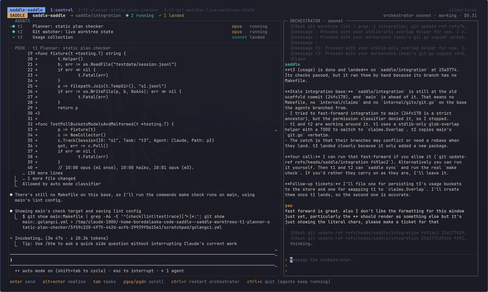

# saddle

Saddle runs a group of coding agents from one terminal. You give it an epic.
It plans a task graph and runs each task as a Claude Code (or Codex or Grok)
agent in its own tmux window and git worktree. It keeps the agents from
colliding, lands their work serially as stacked PRs, and uses a cheap
narrator to tell you what every window is doing.

The goal is that you stop paying Opus to rebase.



*`saddle up` mid-run: three agents (two Opus workers running, one Sonnet task
landed), a live peek at t1's hidden Claude Code terminal, and the Sonnet
orchestrator explaining a stale base and asking before it acts.*

- Design: [TUI canvas](https://claude.ai/artifact/TKRvnLJoDLBonpdKDU19L4)
- Quickstart for a new repo: [docs/QUICKSTART.md](docs/QUICKSTART.md)
- Architecture: [docs/ARCHITECTURE.md](docs/ARCHITECTURE.md)
- Vocabulary: [docs/GLOSSARY.md](docs/GLOSSARY.md)
- Roadmap: GitHub epics, milestone **M0: dogfood**

## How Saddle works

```
spawn ──▶ work ──▶ done ──▶ land ──▶ prs ──▶ merge
 agent    own      gate     merge    stacked   you (or
 + tree   branch   passes   train    GitHub    automerge)
                            onto
                            saddle/integration
```

1. **spawn**: a *task* gets its own branch, git worktree and tmux window, and
   *claims* the paths it will edit so agents don't collide.
2. **work, then `done`**: the agent commits; `done` runs the repo's gate (for
   example `make check`) and queues the branch in the *merge train*.
3. **land**: `saddle land` takes queued branches one at a time: rebase onto the
   integration branch (`saddle/integration`), run the tests, fast-forward. A
   conflict goes back to the agent that wrote it. **Land never pushes** and
   never touches GitHub.
4. **prs**: `saddle prs` pushes landed branches and opens or updates the *stack*
   of PRs, each based on the one below, that close your issues.
5. **merge**: you merge them (or turn on `saddle automerge`).

When the world moves, **restack** rebuilds the landed stack on origin's base
after base moved, a bottom PR merged, or the *sentinel* flagged the stack
*at-risk*. It rebases in train order, moves the branches, pushes and retargets
the PRs; a conflict moves nothing and returns to the task that owns the commit.
You run it when `saddle status` shows `stack_at_risk` or a bottom PR merged.

Other terms you will meet:

- **publish**: open one task's PR on its own against base, when the stack is
  blocked but that task stands alone. **unstack** takes a task out of the stack;
  **requeue** puts a landed task whose work integration lacks back in the train.
- **sentinel**: the watcher that flags the stack *at-risk* or *ci-red*;
  `saddle sentinel ack` acknowledges a flag so it stops holding work back.
- **autopilot**: saddle lands, publishes and tops up from `ready` issues by
  itself; **infinite mode** keeps going until the plan limit and parks there.
- **adapter / harness**: the agent CLI (`claude`, `codex`, `gemini`, `grok`)
  and the one that drives the orchestrator chat.

The full dictionary, with every command and task state, is
[docs/GLOSSARY.md](docs/GLOSSARY.md).

## Quickstart

```sh
make setup            # dev tools; asks for a Jev key / Claude login only if missing
make install          # puts saddle on your PATH
cd your-repo
saddle init           # asks if you trust the folder, then config, git exclude, ref guard hooks
saddle doctor         # preflight checks, grouped by who fixes them; --fix applies the local ones
saddle up             # opens the TUI (harness from config, default claude)
saddle up grok        # or claude / codex, for this run only
```

New to Saddle? [docs/QUICKSTART.md](docs/QUICKSTART.md) walks through
install, `make upgrade`, init, doctor, a first epic, holds and auto-merge.

Then talk to the orchestrator in the right-hand chat:

> work on #46 and #47 in parallel

> here's an epic: …, plan it and show me before starting

The orchestrator is a headless Sonnet session. It reads your issues, proposes
a plan with disjoint path claims, and starts Opus workers once you say go.
The workers run Claude Code in a hidden tmux session. You see them as rows in
**AGENTS** and as a live **PEEK** at the selected one's terminal.

You don't babysit them. When an agent hits a prompt, stops without finishing
or conflicts, Saddle hands its screen to the orchestrator. The orchestrator
answers it if that's safe, or tells you in chat what's needed. Finished agents
call `done`. The orchestrator runs the merge train (one branch at a time, so
moved directories are followed and conflicts go back to the agent that wrote
them) and offers stacked PRs that close the issues.

| Key | |
|---|---|
| `enter` / `alt+enter` | send / newline |
| `tab` | switch between chat and the agent list |
| `j` `k` | select an agent (peek follows) |
| `enter` on an agent | open its real terminal; `ctrl-b d` comes back |
| `x` / `L` | kill the agent / land queued branches; `y` confirms, any other key cancels |
| `ctrl+r` | restart the orchestrator (resumes the conversation) |
| `ctrl+c` | quit. Agents keep running; `saddle up` reconnects |

`saddle down` stops every agent. Worktrees and branches are kept.

Config lives in `.saddle/config.toml` (`saddle init` writes a template):
worker and orchestrator models, concurrency, the test command the merge train
runs, and serial files only the train may touch.

### Orchestrate from Claude Code instead

Saddle also ships as a Claude Code plugin, so your own Claude Code session can
be the orchestrator in place of the TUI's headless Sonnet. With `saddle` on
your PATH:

```
/plugin marketplace add brandonapol/saddle
/plugin install saddle@saddle
```

Then, in a repo where you ran `saddle init`:

> /saddle:orchestrate do #46 and #47 in parallel

The session reads its brief (`saddle plugin brief`), starts
`saddle plugin engine` in the background (the TUI's watchers without the
TUI), plans and spawns workers through the plugin's MCP tools. On Claude Code
2.1.287 or newer the plugin's mod wakes the session when an agent needs
something; on older ones the session keeps a background `saddle plugin wait`
running instead. `/saddle:status` summarizes the agents and the train. The engine
and `saddle up` exclude each other; agents keep running when either stops.
Outside a saddle repo, and inside saddle's own agents, the plugin does
nothing.

Set `harness = "grok"` to run workers and the orchestrator on the [Grok CLI](https://x.ai/cli)
instead of Claude Code. `grok` must be on `PATH` and signed in (`grok login`,
or `XAI_API_KEY`). Workers come up in a tmux window with saddle's hooks and
MCP server installed in that worktree (gitignored). The chat on the right is
one headless grok turn per message, resumed for the rest of the session.
Leave the key unset, or set `harness = "claude"`, to keep Claude Code.
`harness = "codex"` makes the Codex CLI the default worker (the chat stays
on Claude Code for now). `saddle up claude|grok|codex [epic]` picks the
harness for one run without touching config.

Any orchestrator can still spawn a worker on any adapter that can run here
(`claude`, `codex`, `gemini`, `grok`: CLI on `PATH` and signed in) by passing
`adapter` to spawn; `saddle status` lists which are available. Claude and
Grok workers run saddle's hooks, so their claims are enforced on every
write; Codex and Gemini run none, so a saddle pre-commit hook and `done`
check their claims instead (`SADDLE_ALLOW_CLAIMED=1` overrides, and is
logged).

The orchestrator knows the three providers (Anthropic `claude`, SpaceXAI
`grok`, OpenAI `codex`) and picks one per task. When one runs out of quota,
saddle marks it out until its reset and sends new spawns to the next in
`[adapters] order`, telling you in the TUI, in the chat and, if `[notify]`
sets `desktop` or `webhook`, there too:

```toml
[adapters]
order = ["claude", "grok", "codex"]

[notify]
desktop = true
webhook = "https://hooks.example.com/saddle"
```

See [docs/ARCHITECTURE.md](docs/ARCHITECTURE.md#providers-per-task-choice-and-rotation-321).

### Under the hood

The TUI uses the same building blocks you can call yourself:
`saddle spawn | status | claim | done | land | sync | prs | message | kill`.

How agents are kept apart:
- Each agent works in its own worktree.
- A Claude Code PreToolUse hook denies writes to files another task has
  claimed, and the denial names the owner. Unclaimed files are claimed on
  first write.
- Notices reach agents through hooks. Inside a worktree, `saddle sync` rebases
  onto everything that has landed.

### Heavy runs: `saddle run`

Parallel agents that all start `flutter test` or `make check` at once
saturate the machine. `saddle run` queues them on one per-user, per-machine
queue that every session and repo shares:

```
saddle run --class go-test [--prio train|worker|background] [--wait-max 30m] -- make check
saddle runq status [--json] | drain [class] | kill <lease> | slots <class> <n>
```

While it waits it prints one line, such as `queued: position 1 of 2 for go-test,
holder t83 (make check, 40s), ~2m`, and then the command runs as if called
directly. It forwards stdin, stdout, signals and the exit code. It starts in
`observe` mode, which records how long runs take but never makes one wait.
To enforce the slots, set `mode = "enforce"` in `~/.config/saddle/runq.toml`
or `.saddle/runq.toml`. `SADDLE_RUNQ=off|observe|enforce` overrides the mode
for one shell. See [docs/runq.md](docs/runq.md).

### SRE mode: `saddle sre`

Paste an incident and saddle runs the known checks, then spawns read-only
investigators:

```
saddle sre "API 500s since deploy v2.3.1 ..."   # or pipe the text on stdin
saddle sre --dry-run < incident.txt             # run the checks, print the plan, spawn nothing
saddle sre check-config                         # validate .saddle/sre.toml
```

- **`.saddle/sre.toml`** lists the repo's frequent problems as `[[check]]`
  entries (a read-only `command` or a `surface` to look at, plus `expect`),
  its endpoints and its credentials. Credentials are references only, an env
  var name or a `kube-context:`/`vault:` style ref; a plaintext secret fails
  validation.
- **Intake** runs the checks read-only, then plans 3 or 4 disjoint lanes:
  code diffs and deploys, logs and errors, then infrastructure and/or
  dependencies, picked from the incident text and failed checks. One investigator spawns per lane. Only the
  code lane claims paths, the files the incident names.
- **The read-only guard** holds the investigators while the incident in
  `.saddle/sre-incident.json` is open. The hook lets read-only calls run
  (`kubectl get`, `curl` GET, `git log`, the config's own check commands, ...)
  and denies anything that may mutate until one agent states a root cause
  (`saddle sre root-cause`) and a different agent verifies it (`saddle sre
  verify`). Even then a production action does not run: it goes to the
  decision queue as irreversible, and runs only if the owner picks it.
  `saddle sre refute` locks the guard again, `saddle sre incident` shows the
  state and `saddle sre close` ends the incident.
- **Postmortems** go to `docs/postmortems/<date>-<slug>.md`, never
  overwriting an existing file. The writer exists in `internal/sre`; no
  command calls it yet. The checks that found the cause become
  proposed runbook additions in the postmortem; no runbook is edited.

See [docs/sre.md](docs/sre.md) and [docs/postmortems/](docs/postmortems/README.md).
